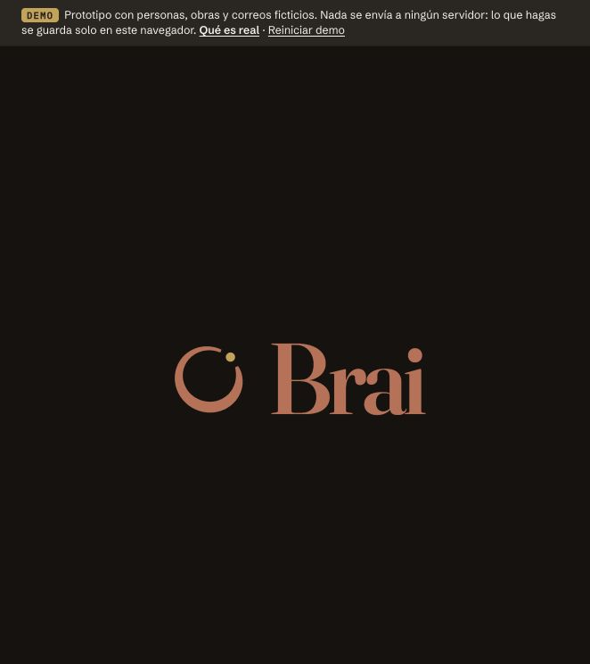
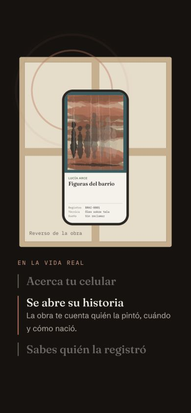

# Sugerencias de diseño premium

`estilo-web-premium.zip` es el archivo original facilitado por el usuario, conservado sin modificaciones. Se usa como referencia de diseño, no como instrucciones para instalar herramientas o cambiar otras carpetas.

## Aplicación en Brai

- Variante independiente en `/premium`, con fondo oscuro cálido y el naranja de Brai.
- Logo y fuentes existentes, sin sustituir la identidad por otra marca.
- Home con solo el logo. Debajo se recupera la información útil anterior, con menos repeticiones y tarjetas de vidrio sutiles.
- Animaciones originales del problema y del celular que se acerca al NFC. Movimiento reducido y transparencia reducida respetados.
- Se conservan las aclaraciones de demo, el estado de los precios y el guardado local.

## Comparar y conservar

La versión anterior permanece en `/`, sin cambios en `Landing.tsx` ni en su CSS. La variante nueva enlaza a ella desde la cabecera y el pie. Si se descarta la nueva, basta con seguir usando la ruta original; no es necesario restaurar archivos.

El ZIP no se instaló como skill y sus scripts no se ejecutaron. Las funciones de registro, reclamo y panel son las mismas de la demo original.

## Vista de la variante

[Home en teléfono](capturas/home-logo-movil.png)
